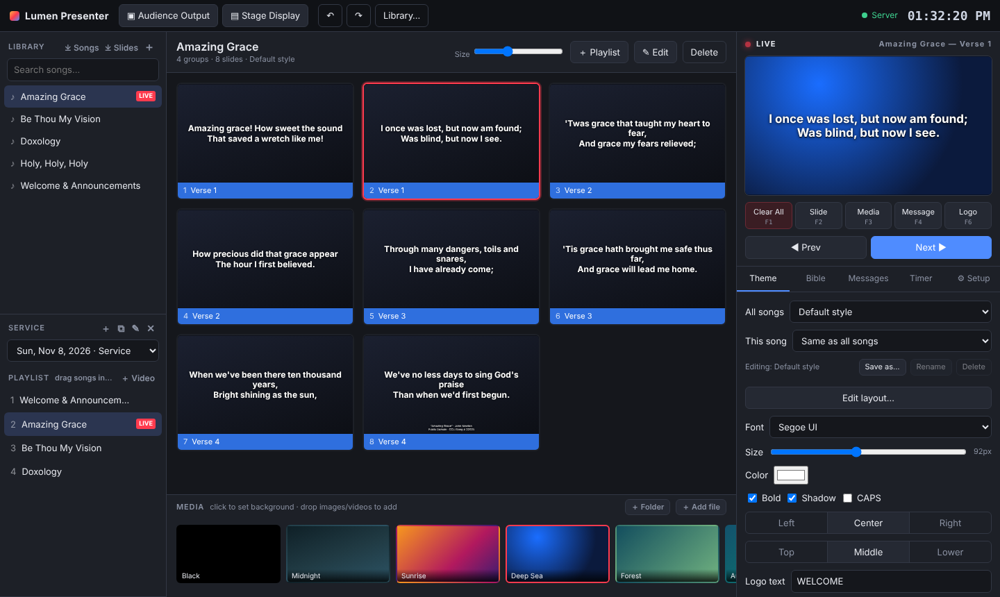
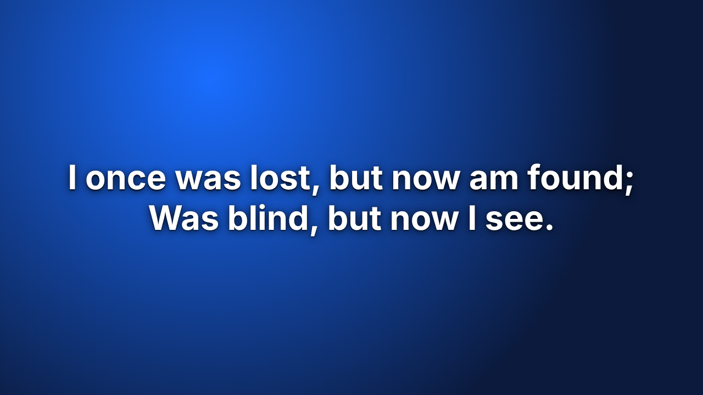
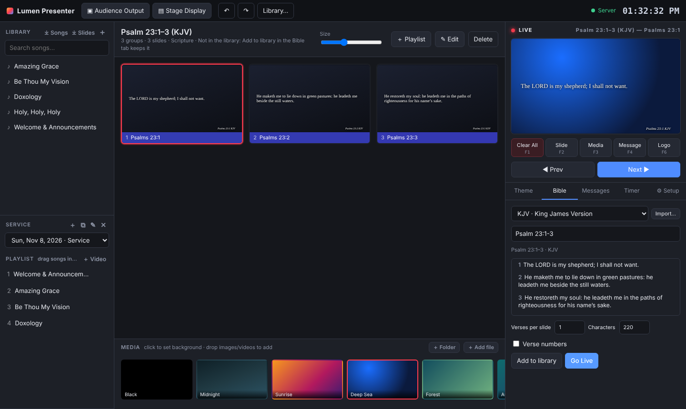
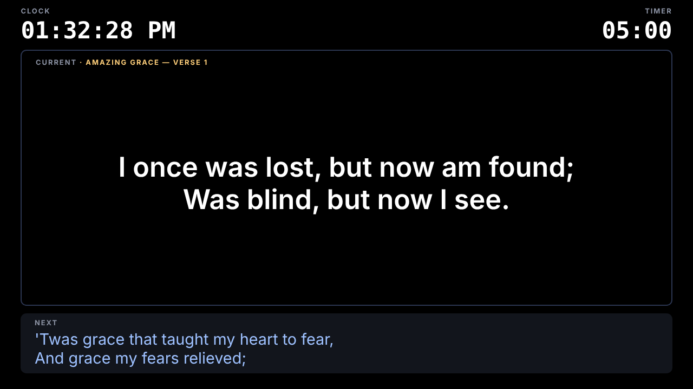
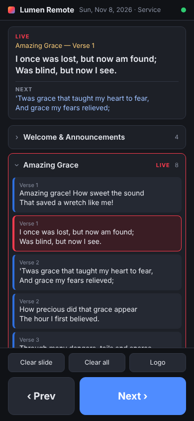

# Lumen Presenter

**Free, open-source church presentation software for worship services and live events, inspired by tools like ProPresenter.**

Lumen Presenter puts worship song lyrics, Bible verses, announcements, pictures, videos and slide decks on the projector, with a stage display for the band and a phone remote for whoever is running the service. It runs as a desktop app for Windows and Linux on the presentation computer, or as a small Node server with no dependencies. Run the operator console on one computer and open the audience output and stage display on any screen on your network, in the app or in any browser.

<p align="center">
  <a href="docs/images/lumen-presenter-operator-console-worship-song-lyrics.png">
    
  </a>
  <br>
  <em>The operator console during a Sunday service: the song library, the service playlist, each verse of the song as a slide, and what is live on the projector.</em>
</p>

## Features

- **Services and playlists.** A dated playlist for each service, stepped through with one key, with auto-advance and looping for announcements.
- **Plain-text slide editor.** Colour-coded groups and a custom play order, so a chorus is written once and sung as often as needed.
- **Scripture.** Find a passage by reference or by its words in the KJV, WEB or BSB, or a Bible you import, and put it on slides in one click.
- **Pictures, videos and slide decks.** Slideshows, videos with synchronised playback on every screen, and PowerPoint, Impress or PDF decks shown exactly as designed.
- **Songs and CCLI.** Search as you type, credits on each song's last slide, a CCLI usage report, and import from SongSelect, ProPresenter 7, EasyWorship (2009, 6 and 7), OpenLP and OpenSong.
- **Themes and transitions.** Saved themes for every song or one presentation, laid out on a canvas with text boxes, shapes, lines, pictures, videos, gradients and a background, several layouts per theme, your own fonts on every screen, bold or coloured single words, designed one-off slides, and cut, fade, dip, push and zoom.
- **Stage display, NDI and phone remote.** A stage clock and next slide for the band, laid out as you like, NDI output (including words only on a transparent background for streaming), and a remote for any phone.
- **Outside control.** Bitfocus Companion (Stream Deck), OSC and MIDI.
- **Never loses the show.** Library, media and live state are saved on disk, so reloading a window or restarting never blanks the projector.

## Screenshots

### Worship lyrics on the projector

<p align="center">
  
</p>

The audience output, full screen on the projector, TV or a livestream through NDI. Each slide is a verse or chorus of the song, with your theme, background and transitions.

### Bible verses on slides

<p align="center">
  
</p>

Type a reference such as *Psalm 23:1-3* or a few words of the verse, and the passage is split into slides in the KJV, WEB, BSB or a Bible translation you import.

### Stage display for the worship team

<p align="center">
  
</p>

A confidence monitor for the band and the speaker, with the current and next slide, a clock and a countdown timer, laid out as you like.

### Phone remote

<p align="center">
  
</p>

Run the slides from any phone on the church network: see what is live and what is next, jump to any song in the service, and step through it with big Prev and Next buttons.

## Quick start

Download the Windows installer or the Linux AppImage or `.deb` from the [Releases page](https://github.com/blue-tj01/LumenPresenter/releases). Installed copies update themselves between services.

To run from the source instead, with [Node.js](https://nodejs.org) 24 or later:

```bash
npm install
npm start          # the desktop app
node server.js     # or just the server; open http://localhost:8642
```

See [Installing and running Lumen](docs/install.md) for unsigned-installer warnings, moving a library across, the Ubuntu AppArmor fix and the **Screens** menu.

## Documentation

| Guide | Covers |
| --- | --- |
| [Installing and running](docs/install.md) | Downloads, updates, running from the source, screens and the tray, server only |
| [Using Lumen](docs/using-lumen.md) | Pages, writing slides, services, scripture, pictures and videos, songs and CCLI, themes, shortcuts |
| [NDI output](docs/ndi.md) | Sending the audience output over NDI, on Windows and Linux |
| [Network mode and control](docs/network-and-control.md) | Other devices, the phone remote, Companion, OSC and MIDI |
| [Server, data and API](docs/server.md) | Options, running as a service or behind a proxy, the data folder and backups, the HTTP API and security |
| [Development](docs/development.md) | Code layout, tests and releasing |

## License

Lumen Presenter is free software: you can redistribute it and/or modify it under the terms of the GNU General Public License as published by the Free Software Foundation, either version 3 of the License, or (at your option) any later version. See [`LICENSE`](LICENSE) for the full text.

It is distributed in the hope that it will be useful, but WITHOUT ANY WARRANTY; without even the implied warranty of MERCHANTABILITY or FITNESS FOR A PARTICULAR PURPOSE.

As an additional permission under section 7 of the GPL, Lumen may be combined with the NDI library from Vizrt NDI AB and conveyed that way; see [`NOTICE`](NOTICE). The Linux builds include that library (`libndi.so.6`), which stays under the NDI SDK License Agreement. More about NDI is at [ndi.video](https://ndi.video/).

NDI® is a registered trademark of Vizrt NDI AB.
